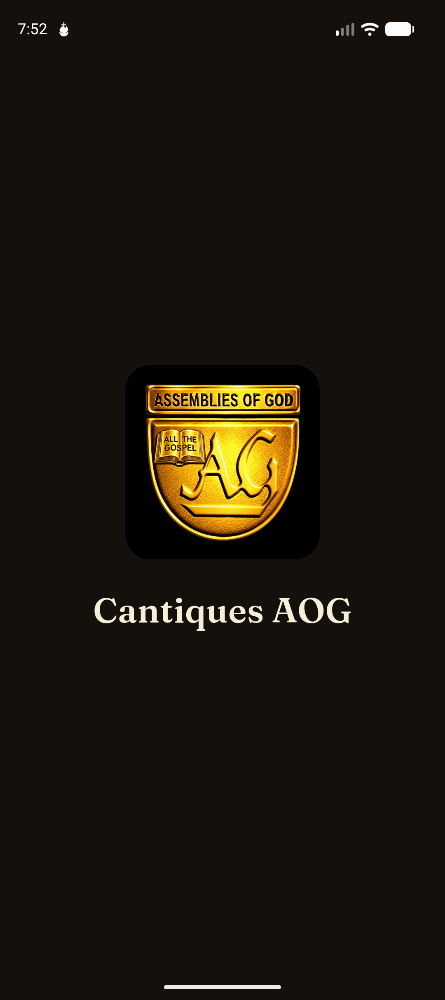
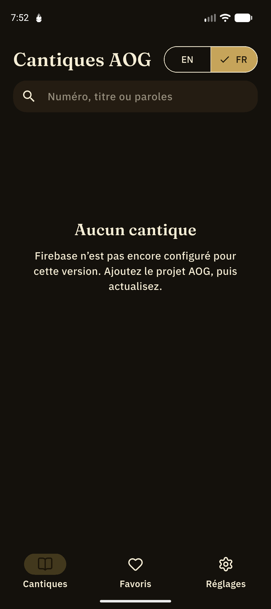
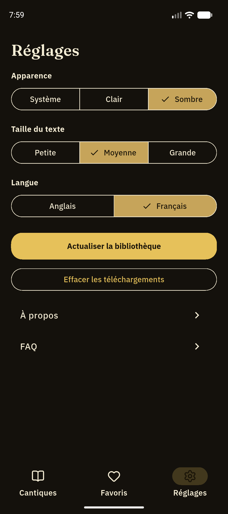

# AOG Hymns

**Assemblies of God hymnbook for phone and projection.**
Paroles, audio, partitions et mode projection, en anglais et en français.

<p>
  
  
  
</p>

Captures sur un Pixel 9. Le catalogue est vide tant que le projet Firebase AOG n'est pas branché.

## What it does

- Hymn list with search
- Hymn page: lyrics, audio, sheet music
- Projection mode for a sanctuary screen
- Favorites and reading settings
- English and French

This app has its own Firebase project and reads the `songs` collection. It does not share a package id or a hymn cache with FGM Hymnals.

## Stack

Flutter, Riverpod, Firebase (Firestore), Slang for the interface strings.

## Run

```bash
flutter pub get
dart run slang
dart run build_runner build --delete-conflicting-outputs
flutter run
```

There is no flavor. `flutter run` is enough.

The Firebase files in the repo are placeholders. Until they are replaced with a real project (`flutterfire configure`), the app opens on an empty setup state.

## Author

Paul Mbou — [github.com/paul-mbou](https://github.com/paul-mbou)
